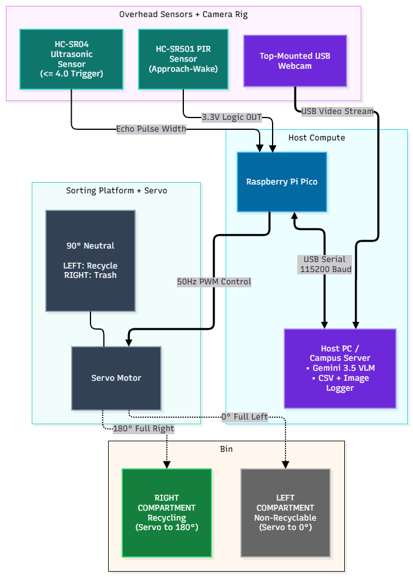
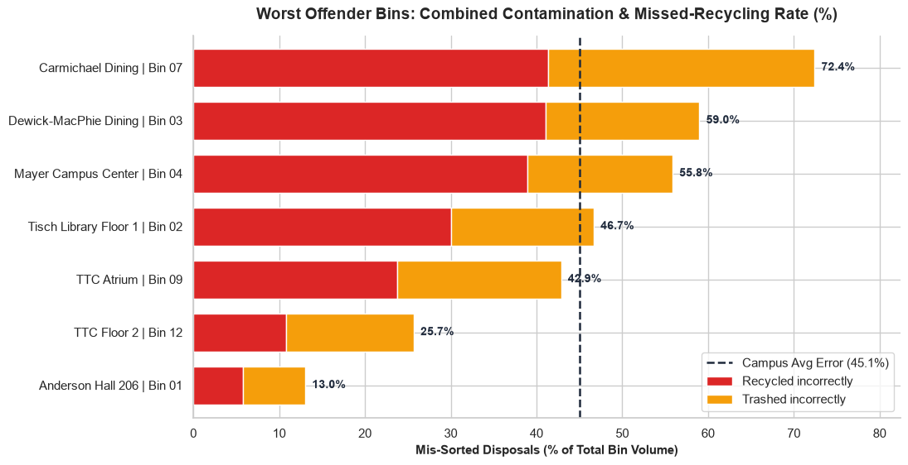
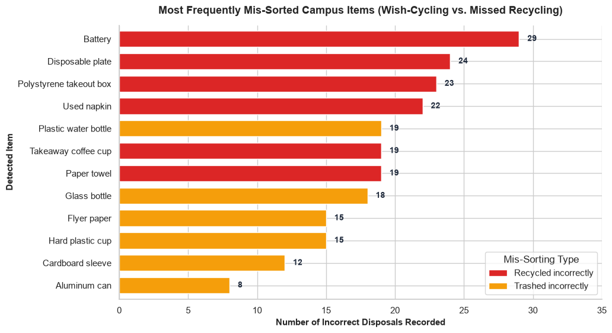
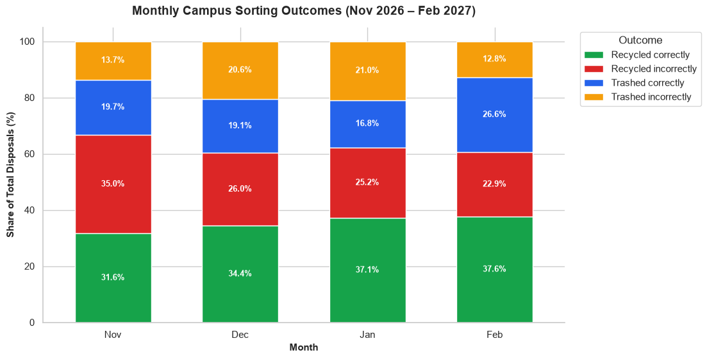

# Sortie: AI-Powered Autonomous Waste-Sorting Bin Extension


## Overview
College campuses struggle with recyclying.

**Sortie** approaches related painpoints at time of disposal:
1. **Physical Sorting:** Users place their waste on the top of either the trash or recycle bin. An overhead camera and Vision LLM classify the object in real time and actuate a servo-driven chute into the recycle or trash compartment, regardless of which side the user placed it on.
2. **Campus Sustainability Data:** By detecting whether the user placed the item on the *Recycle* side (Left) or *Trash* side (Right) of the platform and comparing that against the true classification, we log real-time behavioral analytics (`Recycled correctly`, `Recycled incorrectly`, `Trashed correctly`, `Trashed incorrectly`) to help campus sustainability teams identify which items confuse students most, which months people recycle incorrectly the most in, where people recycle/trash incorrectly the most, etc. in hopes of gaining a better understanding of the kind of localized student behavior across buildings/bins.

## From Closed-Set CV to Open-World Vision LLM

### First Approach and Limitations
Our initial prototype used **`prithivMLmods/Recycling-Net-11`** (~92.9M parameter SigLIP fine-tune) to classify 11 common student waste categories (*aluminium, batteries, cardboard, disposable plates, glass, hard plastic, paper, paper towel, polystyrene, soft plastics, takeaway cups*).

However, first, an 11-way softmax layer requires class probabilities to sum to 100% caused incorrect classification of items beyond the 11 classes (e.g. shoes, electronics, banana peel, etc.). Second, hardcoding in every single possible option seemed time-inefficient.

### Final Solution
We upgraded the vision pipeline to gemini-3.5-flash-lite via the Google GenAI SDK using Pydantic Structured Outputs (BinDecision)
* Accurately identifies any arbitrary object placed on the platform while gracefully rejecting empty backgrounds or hands
* In one quick inference pass, our VLM determines whether the user placed the object on the LEFT (intended to recycle) or RIGHT (intended to trash) half of the platform

## Tech + Hardware Stack
### Software + AI Stack (Host PC)
* **Language:** Python 3.11+
* **Vision LLM:** Google Gemini (gemini-3.5-flash-lite)
* **Computer Vision & Image I/O:** OpenCV (cv2)+ Pillow (PIL)
* **Hardware Bridge:** `PySerial`
### Hardware Stack (Embedded System)
* **Microcontroller:** Raspberry Pi Pico running MicroPython
* **Motion Wake Sensor:** HC-SR501 PIR motion sensor detecting users approaching the bin
* **Proximity Trigger:** HC-SR04 ultrasonic distance sensor confirming an item has been placed on the platform
* **Camera Rig:** Top-mounted downward-facing USB webcam observing strictly only the sorting platform

## System Architecture


## Sample sorting_log.txt Output
```text
Electronics | Trashed correctly | Nov | 11/15/2026 | 17:25:22 | Halligan Floor 2 | Bin 03 | data\20261115_172522_electronics.jpg
Shoe/clothing | Trashed incorrectly | Nov | 11/15/2026 | 07:36:12 | TTC Floor 2 | Bin 12 | data\20261115_172522_shoe_clothing.jpg
Paper towel | Recycled incorrectly | Nov | 11/15/2026 | 07:37:19 | Mayer Campus Center | Bin 04 | data\20261115_172522_paper_towel.jpg
...
--- RUNNING COUNT AFTER 20 ITEMS (11/15/2026 07:45:10) ---
Recycled correctly: 9
Recycled incorrectly: 4
Trashed correctly: 5
Trashed incorrectly: 2
By Month (Sep/ Oct / Nov...):
  [Sep 2026] Recycled OK: 30 | Recycled Bad: 2 | Trashed OK: 51 | Trashed Bad: 32
  [Oct 2026] Recycled OK: 24 | Recycled Bad: 14 | Trashed OK: 34 | Trashed Bad: 41
---------------------------------------------------------------
```

## Campus Sustainability Analytics + Data Science Visuals

### Bin Mis-Sorting Leaderboard
Ranks every monitored bin against the campus-wide average error rate so facilities and sustainability teams know where to prioritize locations for recycling information release.


### Most Frequently Mis-Sorted Items
Breaks down which specific items -- such as plastic-lined takeaway coffee cups, paper towels, water bottles, etc. -- are the most mis-sorted items by trash users.


### Monthly Behavioral Trends (Nov - Feb)
Tracks longitudinal sorting accuracy month-over-month across the academic year.


## Next Steps: Campus Deployment Architecture
To scale **Sortie** across the Tufts University campus buildings through the **Tufts University Green Fund**, we cannot release it with 24/7 idle power draw of placing a dedicated computer laptop at every bin; so, our next step would be to transition from a USB-connected laptop to a **Wireless Cloud Architecture**:

1. **Hardware-Interrupt Deep Sleep (aiming for less than 0.1 mW Idle current draw):**
   * Replace the USB-tethered setup with an ultra-low-power wireless camera microcontroller (such as an **ESP32-S3 CAM** or **Pico W + SPI Camera**).
   * The **HC-SR501 PIR sensor** (~50 µA quiescent current) remains continuously active while the microcontroller, camera, ultrasonic sensor, and Wi-Fi radio remain in deep sleep (~15 µA). Motion triggers a hardware interrupt (`ext0`) to wake the system only when a student approaches.
2. **On-Device TinyML Gatekeeper (Eliminating False Cloud Calls):**
   * Before powering on the Wi-Fi radio, the MCU verifies proximity ($\le 4.0\text{ in}$) via the **HC-SR04** and runs a lightweight quantized **INT8 TinyML object-presence model** locally in SRAM.
   * Empty platforms, shadows, or passing hands are rejected on-device in `< 50ms`, avoiding unnecessary Wi-Fi transmission spikes and data center VLM energy costs.
   * This step could be vital in reducing through-air requests to server and furhter demanding more energy.
3. **Wi-Fi Requests + Telemetry:**
   * Only when a valid waste item is confirmed on the platform does the MCU wake its Wi-Fi radio, send a compressed JPEG with its hardware MAC address (mapping automatically to e.g. `TTC Floor 2 | Bin 12`) to a central campus server, activate the servo from the returned decision, and immediately return to deep sleep.

